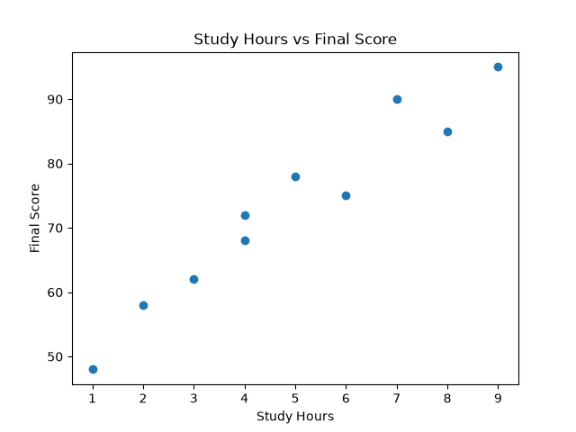
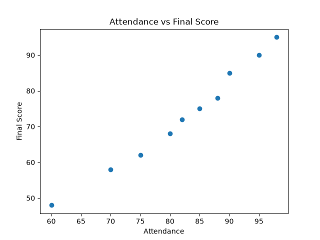

# Student Performance Analysis

## Project Overview

This project analyzes student performance using Python and data analysis techniques.

The goal is to understand how study hours and attendance are related to students' final scores.

## Project Objectives

- Explore student data.
- Analyze factors related to academic performance.
- Calculate statistical correlations.
- Visualize the results using graphs.

## Dataset

The dataset contains 10 student records with the following features:

- Student_ID
- Study_Hours
- Attendance
- Previous_Score
- Final_Score

## Tools and Libraries

- Python
- Pandas
- NumPy
- Matplotlib
- Seaborn
- Scikit-learn

## Key Results

- Average final score: 73.1
- Highest final score: 95
- Lowest final score: 48

### Correlation Results

- Study Hours and Final Score: 0.9684
- Attendance and Final Score: 0.9908

Both variables show a very strong positive correlation with final scores in this dataset.

Correlation does not necessarily imply causation.

## Visualizations

### Study Hours vs Final Score

### Attendance vs Final Score

## Project Status

Exploratory data analysis completed.

Further machine learning steps are planned.